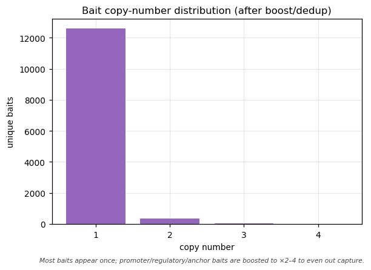
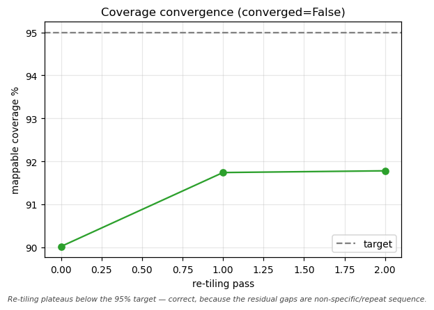
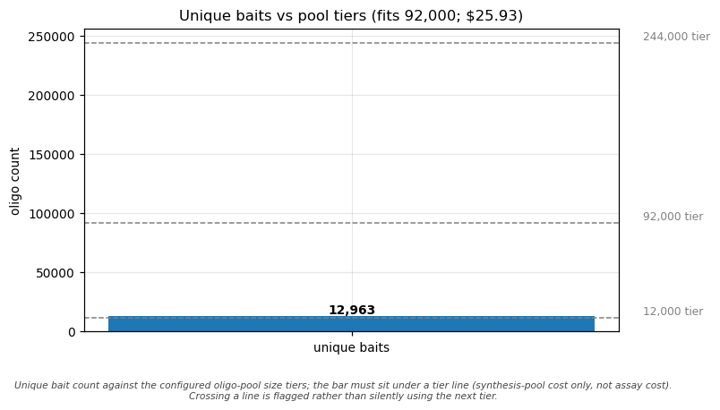

# Introduction

**CaptureForge** turns a **gene list plus per-gene design intent** into **order-ready biotinylated-bait
oligo sequences** and a full QC/design report. It is a reusable, **disease- and organism-agnostic** method
tool: the first use was a multi-gene human study-susceptibility panel, but nothing in its structure or
defaults is study-specific — point it at any gene list (any disease, any study) and, where feasible, any
reference genome, by changing **inputs and configuration only**, with no code edits.

Everything upstream of physical oligo synthesis is in scope. Synthesis is outsourced, so the final
deliverables are **order-ready sequence files**, a self-contained QC dashboard, and a clean
`final_covered_targets.bed` handoff for a downstream variant-analysis pipeline (a separate tool).

> CaptureForge **designs** baits. It does not order, synthesize, or contact any vendor, and it does not run
> downstream variant analysis.

## When to use hybridization capture (vs amplicon vs WGS)

| Approach | Best when | Trade-offs |
|---|---|---|
| **Hybridization capture** (CaptureForge) | Tens to thousands of targets; large or scattered regions (whole genes, promoters, CNV loci); flexible panel that you will revise | Higher up-front design effort; even coverage; tolerant of variation under the probe |
| **Amplicon / multiplex PCR** | Small, fixed sets of short, well-defined regions (hotspots); lowest cost per sample at small scale | Primer design is brittle near variants/repeats; hard to scale to whole genes |
| **Whole-genome sequencing** | You need the whole genome, or targets are unknown | Most sequencing per sample; most cost; most data to store/analyze |

Use capture when you want **gene-level** coverage of a curated panel with room to grow, and you can tolerate
masked/uncapturable sequence (repeats, segmental duplications) being intentionally left out.

## Who this manual is for

Bioinformaticians and core-facility staff who will **run** CaptureForge to design a panel, **interpret** its
QC, and **prepare an order**. It assumes comfort with the command line, Nextflow, and conda/containers, but
explains the genomics concepts where they matter for decisions.

---

# Concepts

## What a capture bait (probe) is

A **bait** (or **probe**) is a short, single-stranded, biotinylated oligonucleotide — in CaptureForge,
**120 nt** by default — whose sequence is complementary to a region you want to sequence. A **panel** is
simply the **set of baits** that together tile all your targets.

## How hybridization capture works

1. **Library prep** — fragment sample DNA and add sequencing adapters.
2. **Hybridization** — denature the library and add the bait pool; baits anneal to their complementary
   fragments in solution.
3. **Streptavidin pulldown** — magnetic streptavidin beads bind the biotin on the baits, pulling down the
   bait–fragment duplexes.
4. **Wash** — wash away unbound (off-target) fragments.
5. **Enriched library** — elute, amplify, and sequence — now strongly enriched for your targets.

CaptureForge designs step 2's reagent: the bait pool. A bait tolerates some mismatch to its target (so it
captures variants *under* the probe), which is also why **specificity** matters — a bait too similar to an
off-target locus will pull that locus down too.

## Per-region design classes

Not every target should be tiled the same way. CaptureForge tags each target interval with a **design class**
that drives its tiling density, masking policy, GC policy, and boosting:

| Class | What it targets | Tiling / policy |
|---|---|---|
| `coding` | canonical-transcript exons (incl. UTRs) ± splice flanks | 2× tiling, step = ½ bait; standard masking |
| `promoter` | strand-aware TSS window | 3× tiling, step = ⅓ bait; low-complexity **relaxed**; high-GC bound relaxed; boosted |
| `regulatory` | Regulatory-Build / cCRE features over the locus (if provided) | as promoter |
| `cnv` | the whole gene locus | 2× **even** tiling for read-depth CNV calling |
| `str` | the **unique flanks** of a short-tandem-repeat locus | the repeat core is removed at masking; tile flanks only |
| `anchor` | an rsID ± flank | ensure ≥2 baits span the variant; minimal masking |

`coding` is always implied for every gene. The other classes are added per your input (see *Preparing inputs*).
This is why a CNV gene and an STR gene that overlap the same locus produce visibly different bait layouts.

---

# Pipeline architecture

CaptureForge is a **Nextflow (DSL2)** pipeline. `main.nf` calls one subworkflow
(`subworkflows/captureforge.nf`) that chains 14 processes: a FASTA-index step, the ten design stages, and two
visualization steps. Each stage is a module in `modules/` that wraps a tool in `bin/`, writes its outputs
under `results/<outdir>/stageN_*/`, and emits a `stageN_summary.json` of metrics.

| Stage | Module / tool | Consumes | Emits |
|---|---|---|---|
| 1 — Target definition | `define_targets.py` | gene list + GTF | `targets.raw.bed` (labelled `gene\|class\|subtype`) |
| 2 — Masking | `apply_masking.py` (dustmasker + rmsk/simpleRepeat) | `targets.raw.bed` + genome | `targets.masked.bed`, `targets.lost_to_mask.bed`, `*.str_core.bed` |
| 3 — Tiling | `tile_candidates.py` (bedtools) | masked targets + genome | `candidates.bed`, `candidates.fasta` |
| 4 — Specificity | `specificity_filter.py` (blastn / bowtie2) | candidates + specificity index | `candidates.specpass.bed`, `candidates.spec.tsv` |
| 5 — Composition | `composition_filter.py` (primer3) | spec-pass baits | `composition.pass.bed/fasta`, `composition.tsv` |
| 6 — Re-tiling | `gap_retile.py` (reuses 4+5) | masked targets + passing baits | `retiled.pass.bed/fasta`, `residual_gaps.bed` |
| 7 — Boost / dedup | `boost_dedup.py` | re-tiled baits | `baits.dedup.bed/fasta/tsv` |
| 8 — Synthesis | `scaffold_synthesis.py` | dedup baits | `synthesis.fasta`, `synthesis.tsv` |
| 9 — QC aggregation | `aggregate_qc.py` | all stage summaries + BEDs | `final_covered_targets.bed`, `metrics.json`, `coverage_by_{gene,class}.tsv` |
| 10 — Export | `export_package.py` | dedup + synthesis + QC | `baits.fasta`, `baits.csv`, `order_generic.tsv`, `MANIFEST`, `provenance.json` |
| viz | `make_figures.py`, `make_dashboard.py` | QC + BEDs | `figures/*.png/svg`, `qc_dashboard.html` |

The pipeline is driven by **profiles** (`-profile test|mac_local|hpc_slurm`) that select the executor and
resources, composed with a **container engine** profile (`conda|docker|apptainer`). An interactive DAG of the
run is also written to `results/<outdir>/pipeline_info/dag.html`, alongside `report.html`, `timeline.html`,
and `trace.txt`.

{width=58%}

---

# Installation

## Prerequisites

- **Nextflow** ≥ 23.10 (needs **Java 17+**). The repo also bundles a launcher at `./.tools/nextflow`.
- **conda / mamba** (for the pinned environment) **or** Docker / Apptainer (for the container).

## conda environment

The pinned environment in `env/captureforge.yml` provides the whole toolchain (bedtools, samtools, seqkit,
bowtie2, bwa-mem2, genmap, BLAST/dustmasker, primer3, pysam, Biopython, pyfaidx, pandas, openpyxl, jinja2,
matplotlib, ViennaRNA, …).

```bash
# Linux (native):
mamba env create -f env/captureforge.yml

# macOS Apple Silicon (arm64): build under Rosetta so all bioconda packages resolve
CONDA_SUBDIR=osx-64 mamba env create -f env/captureforge.yml
```

> **Apple-Silicon PATH note.** The env builds as osx-64 under Rosetta. If you run `-profile <x>,conda`,
> Nextflow manages the environment for you. If instead you pre-activate the env and run without the `conda`
> engine, make sure the env's `bin` is first on `PATH`, so `/usr/bin/env python3` resolves to the env's
> interpreter (not Homebrew's):
> ```bash
> conda activate captureforge && export PATH="$CONDA_PREFIX/bin:$PATH"
> ```

## Containers

```bash
docker build -t captureforge:0.1.0 -f env/Dockerfile .       # Mac/CI development
apptainer build captureforge.sif env/captureforge.def        # HPC (Docker usually banned)
```

## HPC / Lmod (central install)

A shared install lets others `module load captureforge` and run a wrapper. See `docs/hpc_deployment.md` for
the full recipe; the pieces are:

- `share/modulefiles/captureforge/0.1.0.lua` — Lmod modulefile stub (edit `install_root` / `refs_root`).
- `share/bin/captureforge-run` — wrapper that forwards to `nextflow run … -profile hpc_slurm,apptainer`.

```bash
module use /shared/apps/captureforge/share/modulefiles
module load captureforge/0.1.0
captureforge-run -params-file my_panel.params.yaml --slurm_partition <queue>
```

---

# Preparing inputs

CaptureForge auto-detects the input format and normalizes **any one** of three on-ramps into a single
internal target table (`stage1_targets/targets.tsv`). The logic that turns genes into labelled regions is
**Stage 1 of the pipeline itself** — no prior project file or script is ever required. The schema is
documented in `assets/gene_list_schema.md`.

## On-ramp 1 — Plain-text symbols (zero friction)

One gene symbol per line. Blank lines and `#` comments are ignored. Applies the **default design classes**
(`params.default_classes` = `coding,promoter`).

```text
# my_genes.txt
GENE
GENE
GENE
```

## On-ramp 2 — CSV/TSV spec (the reusable format)

Header **`gene`** is required; all others optional. Boolean-ish columns accept `1/0`, `yes/no`, `true/false`.

| column | meaning |
|---|---|
| `gene` (**required**) | gene symbol (aliases in parentheses tolerated) |
| `promoter` | add the strand-aware promoter window |
| `regulatory` | intersect the Regulatory-Build / cCREs over the locus |
| `cnv` | add even-tiled CNV windows over the locus |
| `str` | tile unique flanks only (skip the repeat core) |
| `extra_regions` | extra intervals `chr:start-end` separated by `;` |
| `anchors` | rsIDs / variant tokens separated by `,` or `;` |

```csv
gene,promoter,regulatory,cnv,str,extra_regions,anchors
GENE,1,0,0,0,,
GENE,0,0,1,0,,
GENE,1,1,0,0,,rs1042522
GENE,1,1,0,1,,
```

### Scaffolding a spec from bare symbols

`bin/init_gene_list.py` turns a bare symbol list into an editable spec CSV pre-filled with the default
classes, ready for you to add `promoter/regulatory/cnv/str/anchor` intent per gene:

```bash
python bin/init_gene_list.py my_genes.txt -o my_panel.spec.csv
# then edit my_panel.spec.csv and run with --input my_panel.spec.csv
```

## On-ramp 3 — Rich curated workbook (`.xlsx`)

Reads the sheet named by `--excel_sheet` (default `Candidate Panel (expanded)`); the header row is detected
automatically (the row containing a `Gene` cell). Recognized columns: `Gene` (required), `Variant class`,
`Key variants to capture`, `Locus`, `Burden group`.

### How `Variant class` text maps to design classes

The mapping is case-insensitive substring matching (`coding` is always added):

| text contains | adds class |
|---|---|
| `reg`, `promoter`, `enhancer`, `regulatory`, `haplotype` | `promoter` (+ `regulatory` if `enhancer`/`distal`/`regulatory`) |
| `cnv`, `copy number`, `structural`, `deletion`, `duplication` | `cnv` |
| `str`, `repeat`, `tandem`, `microsatellite`, `expansion` | `str` |
| anything else (`coding`, `LoF`, `burden`, …) | `coding` |

### Aliases and anchors

Symbols written `A (B)` are resolved to whichever of `A`/`B` is a valid current symbol in the GTF
(`GENE (GENE)`→`GENE`, `GENE (GENE)`→`GENE`). Unresolvable symbols cause a **loud failure** with the
offending list. `rs\d+` tokens in `Key variants to capture` / `anchors` are extracted as anchor targets
(resolved to coordinates via a dbSNP VCF or a `--rsid_bed`; see *Reference data*).

---

# Reference data

CaptureForge reference paths are parameters; you supply at minimum a **genome FASTA** and a **GTF**. Optional
tracks (RepeatMasker, simpleRepeat, segmental dups, a regulatory build, dbSNP) improve masking and anchors
but are not required.

## Fetching human GRCh38 references

`bin/fetch_references.sh` downloads and **checksums** each reference and writes a provenance manifest. It is
**GRCh38/human-specific** (Ensembl `homo_sapiens` + UCSC hg38). Heavy downloads never run automatically.

```bash
bin/fetch_references.sh --outdir refs gtf                 # just the Ensembl r112 GTF (~50 MB)
bin/fetch_references.sh --outdir refs rmsk simplerepeat   # STR/repeat masks
bin/fetch_references.sh --outdir refs all                 # everything (heavy!)
```

For **non-human** organisms, fetch the genome FASTA and GTF yourself (Ensembl / Ensembl Genomes / PlasmoDB)
and pass them with `--genome_fasta` / `--gtf` (see *Running on different organisms*).

## The no-alt reference invariant (read this)

> **Specificity must run against the NO-ALT primary assembly, and the specificity index must be the SAME
> reference as the design genome.**

If you index a *toplevel / with-alt* reference, genes in the MHC and other alt-haplotype regions will look
non-specific against **their own alternate-haplotype copies** — a real example from the human panel: complement
factor B (`GENE`) initially appeared 100% non-specific because its "off-targets" were its own copies on six
`HSCHR6_MHC_*` scaffolds. CaptureForge **enforces** this: Stage 4 (`specificity_filter.py`) fails loudly
(exit 3) if the specificity reference contains alt/decoy/HLA contigs (`HSCHR*`, `*_MHC_*`, `HLA-*`, `*_alt`,
`*_decoy`, `hs38d1`, `EBV`) and cross-checks that the db contigs are a subset of the design genome. The check
fired on the production run: *"reference invariant OK: 194 contigs, no alt/decoy/HLA."*

## Building the specificity index

Build the index **from the no-alt design genome**:

```bash
# BLAST (no index-build wait; used in the local human run)
bin/build_specificity_index.sh \
    --fasta GRCh38.primary_assembly.fa \
    --aligner blast \
    --out $PWD/refs/grch38_noalt
# bowtie2 (native, recommended on the HPC)
bin/build_specificity_index.sh \
    --fasta GRCh38.primary_assembly.fa \
    --aligner bowtie2 \
    --out $PWD/refs/grch38_noalt_bt2
```

`--specificity_db` is referenced **in place** (not staged into work dirs), so it **must be an absolute path**
to the index prefix.

---

# Configuration

## Profiles

| Profile | Executor / use | Compose with |
|---|---|---|
| `test` | tiny mini-genome fixture; runs on a laptop in ~2 min | `,conda` / `,docker` |
| `mac_local` | full pipeline on one machine (local executor) | `,conda` / `,docker` |
| `hpc_slurm` | SLURM executor; big slots for the heavy specificity step | `,apptainer` |

Container-engine profiles `conda`, `docker`, `apptainer` are composed, e.g. `-profile hpc_slurm,apptainer`.

## Key parameters (real defaults from `nextflow.config`)

| Param | Default | Meaning |
|---|---|---|
| `bait_len` | `120` | bait length (nt) |
| `canonical_source` | `mane` | transcript pick: `mane` → `ensembl_canonical` → `longest` fallback |
| `splice_flank` | `15` | bp added around each exon |
| `promoter_upstream` / `promoter_downstream` | `2000` / `200` | TSS−2000 .. TSS+200 |
| `anchor_flank` | `150` | bp each side of an rsID anchor |
| `default_classes` | `[coding, promoter]` | applied to a bare symbol list |
| `tiling` | per-class `density` / `step_frac` / `even` | tiling policy (coding ½-step, promoter/reg ⅓, cnv even, str ⅓ flanks) |
| `specificity_aligner` | `bowtie2` | `bowtie2` \| `bwa` \| `blast` |
| `specificity_db` | `null` | aligner index / BLAST db prefix (**absolute path**, no-alt) |
| `offtarget_min_identity` | `0.90` | secondary-hit identity threshold |
| `offtarget_min_lenfrac` | `0.50` | secondary-hit length fraction |
| `offtarget_max_hits` | `1` | tolerated off-target hits before reject |
| `gc_min` / `gc_max` | `0.25` / `0.70` | GC window (fraction) |
| `gc_max_promoter` | `0.80` | relaxed upper GC for promoter/regulatory |
| `homopolymer_max` | `10` | max homopolymer run |
| `tm_min` / `tm_max` | `60.0` / `90.0` | nearest-neighbour Tm window (°C) |
| `retile_max_passes` | `3` | max gap re-tiling passes |
| `coverage_target` | `0.95` | target fraction of **masked** target to cover |
| `bait_format` | `ivt_rna` | `dna_pool` \| `ivt_rna` \| `ready_to_use` |
| `synth_max_len` | `170` | vendor synthesis length ceiling (nt) |
| `per_oligo_price` | `0.00200` | USD per oligo (**placeholder**) |
| `pool_tiers` | `[12000, 92000, 244000]` | oligo-pool size tiers |
| `outdir` | `results` | output directory |

> Some advanced parameters are present for documentation but are **not currently wired** to a stage — see
> *Troubleshooting → Known doc-vs-behaviour notes*.

---

# Running the pipeline

The bundled launcher is `./.tools/nextflow`; if you installed Nextflow on `PATH`, use `nextflow`.

## Quickstart — the `test` profile (10 genes, ~2 min)

```bash
conda activate captureforge && export PATH="$CONDA_PREFIX/bin:$PATH"   # Apple-Silicon PATH note
bash test/data/make_test_reference.sh        # build a tiny mini-genome fixture from your local GRCh38
./.tools/nextflow run main.nf -profile test  # or: -profile test,conda
bash test/check_outputs.sh                    # sanity-check; expects all 6 design classes
```

## Full run — `mac_local`

```bash
bin/build_specificity_index.sh \
    --fasta GRCh38.primary_assembly.fa \
    --aligner blast \
    --out $PWD/refs/grch38_noalt
conda activate captureforge && export PATH="$CONDA_PREFIX/bin:$PATH"
./.tools/nextflow run main.nf -profile mac_local -params-file params.full.yaml
```

## Full run — `hpc_slurm` with Apptainer

```bash
apptainer build captureforge.sif env/captureforge.def
nextflow run /shared/apps/captureforge/main.nf -profile hpc_slurm,apptainer \
    -params-file my_panel.params.yaml \
    --genome_fasta $CF_REFS/GRCh38.primary_assembly.fa \
    --gtf $CF_REFS/GRCh38.112.gtf.gz \
    --specificity_db $CF_REFS/grch38_noalt_bt2 \
    --specificity_aligner bowtie2 \
    --rmsk_bed $CF_REFS/rmsk.GRCh38.txt.gz \
    --simplerepeat_bed $CF_REFS/simpleRepeat.GRCh38.txt.gz \
    --rsid_bed $CF_REFS/anchors.rsid.bed \
    --slurm_partition <queue> \
    --scratch_dir $TMPDIR \
    --outdir results
```

---

# Running on different organisms

CaptureForge is organism-agnostic: you change **inputs and parameters**, not code. The same Stage 1–10
pipeline runs for any species given a genome FASTA + GTF and a specificity index built from that genome. Below
are real, runnable command shapes for three organisms plus a general checklist.

The two things that most often need per-organism attention are: (1) the **canonical-transcript source** (MANE
exists only for human) and (2) the **GC/Tm windows** (an AT-rich genome will reject most baits at the human
default GC window).

## Human (GRCh38) — the baseline

This is the panel already run; it uses MANE Select canonical transcripts and the full set of human tracks.

```bash
./.tools/nextflow run main.nf -profile mac_local \
    --input my_panel.spec.csv \
    --genome_fasta refs/GRCh38.primary_assembly.fa \
    --gtf refs/Homo_sapiens.GRCh38.112.gtf.gz \
    --specificity_db $PWD/refs/grch38_noalt \
    --specificity_aligner blast \
    --rmsk_bed refs/rmsk.GRCh38.txt.gz \
    --simplerepeat_bed refs/simpleRepeat.GRCh38.txt.gz \
    --rsid_bed refs/anchors.rsid.bed \
    --canonical_source mane
```

## Mouse (GRCm39, Ensembl) — MANE-absent fallback

Mouse has **no MANE**. With `--canonical_source mane`, CaptureForge falls back automatically
(MANE_Select → Ensembl_canonical → longest); the mouse Ensembl GTF carries `Ensembl_canonical` tags, so you
can also set it explicitly. Mouse has an Ensembl **Regulatory Build** (pass it as a GFF) but you will supply
your own variant BED for anchors.

```bash
# fetch GRCm39 primary assembly + GTF from Ensembl yourself, then:
bin/build_specificity_index.sh \
    --fasta GRCm39.primary_assembly.fa \
    --aligner bowtie2 \
    --out $PWD/refs/grcm39_bt2

./.tools/nextflow run main.nf -profile mac_local \
    --input mouse_panel.spec.csv \
    --genome_fasta refs/GRCm39.primary_assembly.fa \
    --gtf refs/Mus_musculus.GRCm39.112.gtf.gz \
    --specificity_db $PWD/refs/grcm39_bt2 \
    --specificity_aligner bowtie2 \
    --canonical_source ensembl_canonical \
    --regulatory_gff refs/Mus_musculus.GRCm39.regulatory_features.gff.gz \
    --rsid_bed refs/mouse_anchors.bed   # user-supplied (chrom start end id), optional
```

**Caveats:** `fetch_references.sh` is human-only — fetch mouse refs manually. UCSC `rmsk`/`simpleRepeat` use
`mm39` (not the hg38 paths in the script); if you don't supply them, masking falls back to **dustmasker**
(low-complexity) and STR-core removal is weaker (still functional). dbSNP anchors require a user BED.

## Plasmodium falciparum — non-model, AT-rich genome

*P. falciparum* is ~**81% AT** (≈19% GC). Two things change materially:

- **There is no MANE and usually no `Ensembl_canonical` tag** in PlasmoDB/Ensembl-Protists GTFs → canonical
  selection falls back to the **longest** transcript. Set `--canonical_source longest` explicitly.
- **The default GC window (0.25–0.70) rejects most baits**, because most *P. falciparum* sequence has GC
  below 25%. You must **widen and shift the GC window down**, and lower the Tm floor (AT-rich baits melt
  lower). Without this, Stage 5 will reject the large majority of candidates.

```bash
# Gene models from PlasmoDB / Ensembl Protists; primary assembly (no alts):
bin/build_specificity_index.sh \
    --fasta PlasmoDB-Pf3D7_Genome.fasta \
    --aligner bowtie2 \
    --out $PWD/refs/pf3d7_bt2

./.tools/nextflow run main.nf -profile mac_local \
    --input pf_drug_resistance.spec.csv \
    --genome_fasta refs/PlasmoDB-Pf3D7_Genome.fasta \
    --gtf refs/PlasmoDB-Pf3D7.gtf \
    --specificity_db $PWD/refs/pf3d7_bt2 \
    --specificity_aligner bowtie2 \
    --canonical_source longest \
    --gc_min 0.15 --gc_max 0.55 \
    --gc_max_promoter 0.60 \
    --tm_min 50 --tm_max 85
```

This ties directly to the facility's study work: a *P. falciparum* drug-resistance panel (e.g. *pfcrt*,
*pfmdr1*, *dhfr*, *dhps*, *kelch13*) is designed exactly this way — coding classes for the resistance genes,
the widened GC/Tm windows above, and a specificity index built from the Pf3D7 primary assembly.

**Caveats:** no regulatory build and no dbSNP — `regulatory` flags produce nothing (but **promoter windows
still work**, since they come from the GTF TSS), and anchors require a user-supplied BED. No UCSC repeat
tracks — masking is **dustmasker-only** (which is actually well-suited to the AT-rich, low-complexity-rich Pf
genome). The no-alt invariant still applies: Pf has no alt haplotypes, so the check simply passes.

## "Any organism" checklist

Before a new-organism run, confirm:

1. **Minimum inputs:** a gene list; a **no-alt primary-assembly** genome FASTA; a matching GTF with
   `gene_name` attributes; a specificity index **built from that FASTA** (absolute path).
2. **Canonical source:** `mane` only for human; use `ensembl_canonical` (most Ensembl species) or `longest`
   (non-model) otherwise.
3. **GC/Tm windows:** check the genome's GC content. AT-rich (Plasmodium, many bacteria) → lower `gc_min`,
   lower `gc_max`, lower `tm_min`. GC-rich → raise the window.
4. **Optional tracks:** supply `rmsk_bed`/`simplerepeat_bed` (correct assembly!) and `regulatory_gff` if they
   exist; otherwise masking is dustmasker-only and `regulatory` classes are empty (promoter still works).
5. **Anchors:** supply `--rsid_bed` (or a tabix dbSNP VCF via `--dbsnp_vcf`) only if you flagged anchors.
6. **Contig naming:** the genome FASTA, GTF, and any tracks must use the **same** contig names; UCSC
   `chr`-prefixed tracks are normalized to Ensembl naming automatically, but mismatched assemblies are not.

---

# Outputs explained

All outputs land under `results/<outdir>/`. The deliverables a user cares about:

## `order_package/`

- **`baits.fasta`** — the final, order-ready bait constructs (for `ivt_rna`, each is
  `handle5 + T7 + bait + handle3`). FASTA header carries `copies=` and `fmt=`.
- **`baits.csv`** — one row per unique bait, full metadata. Columns:

  | column | meaning |
  |---|---|
  | `bait_id` | stable unique id (`CF_NNNNNN\|gene\|class`) |
  | `sequence` | the final synthesis construct (handles + bait for `ivt_rna`) |
  | `copy_number` | how many times this bait is represented in the pool (boosting; see Stage 7) |
  | `gene` | source gene(s) |
  | `class` | design class(es) the bait came from |
  | `source_region` | the genomic region(s) it tiles |
  | `strand` | `+` / `-` |
  | `GC` | GC fraction of the **bait core** (the hybridizing 120-mer) |
  | `Tm` | nearest-neighbour Tm (°C) of the core |
  | `off_target_flag` | `1` if the bait retains a tolerated paralog/off-target hit, else `0` |

- **`order_generic.tsv`** — a vendor-neutral order table (`Pool_Name, Probe_ID, Sequence, Replicates`).
- **`MANIFEST`** — md5 checksums of the key outputs.
- **`provenance.json`** — tool versions, reference releases, `git_commit`, `design_genome`, and
  `specificity_reference` (so every output records exactly which reference produced it).

## `stage9_qc/`

- **`final_covered_targets.bed`** — **the handoff to a downstream analysis pipeline.** This is the
  **AS-BUILT** coverage: the intersection of your raw targets with what the final baits actually cover,
  labelled `gene|class`. **It is not the raw target set** — measure downstream variant calls against this
  file, because it represents the regions you can actually expect reads in.
- `metrics.json`, `coverage_by_gene.tsv`, `coverage_by_class.tsv` — machine-readable QC.

## `qc_dashboard.html` and `figures/`

A self-contained HTML dashboard (open in a browser) embeds every figure and the key metrics tables. All
figures are also written as **PNG + SVG** under `figures/`. Per-stage intermediates live under
`stage1_targets/` … `stage8_synthesis/`; `pipeline_info/` holds the Nextflow `report/timeline/trace/dag`.

---

# Interpreting QC and coverage

This is the most important section for making good decisions.

## Mappable vs raw coverage

CaptureForge reports coverage two ways:

- **mappable coverage** = covered ÷ **masked (tileable)** target — design efficiency over sequence you can
  actually bait.
- **raw coverage** = covered ÷ **raw** target — the honest end-to-end number over the *nominal* footprint.

On the multi-gene human panel the overall figures are **~NN.N% mappable** but **~NN.N% raw**. **This is by
design.** The gap is sequence intentionally removed by masking — repeats, segmental duplications, STR cores,
Alu elements — which is **genomically uncapturable** by hybridization. A high mappable number with a lower
raw number is the *expected, honest* result, not a failure.

{width=85%}

{width=70%}

To see *how* each gene's baits are composed by design class, the per-gene-by-class view stacks bait counts
per gene (counts from `baits.csv`, multi-class baits attributed to their primary class so the bars sum to
the unique-bait count). It makes the design intent obvious at a glance — GENE is dominated by `str`
(its unique flanks), GENE/GENE/GENE by `cnv` (whole-locus tiling), and most other genes are `coding`+`promoter`.
The full gene × class matrix is in *Appendix A* (and `figures/baits_per_gene_by_class.tsv`).

{width=72%}

{width=72%}

## The three-tier per-gene honesty

Not all "incomplete" coverage means the same thing. Genes fall into three tiers:

1. **Cleanly covered** — unique sequence, high mappable coverage (most of the panel).
2. **Paralog-limited coding** — only the *uniquely-baitable fraction* is covered; the rest is too similar to a
   paralog to bait specifically. Real panel examples: **GENE** (paralog GENE), **GENE** (GENE/5 cluster),
   **GENE** (GENE + internal repeats), **GENE** (GENE), **GENE** (GENE–5). The 691 baits that retain one tolerated
   paralog hit are tagged `off_target_flag=1` in `baits.csv`.
3. **CNV breakpoint-blind** — for CNV genes, depth bins are evenly spaced *except* across segmental-dup / LCR
   regions, which are exactly where the structural variation often occurs. Real examples: **GENE** (max bin gap
   18.5 kb) and **GENE** (max gap 6.6 kb).

> **GENE and GENE are in BOTH tier 2 and tier 3** — they are the loci most likely to need an **orthogonal
> assay** (MLPA / long-read) if they are central to your study.

## CNV read-depth callability is the decision metric — not raw CNV coverage

For a CNV gene, the question is not "what % of the locus is baited" but "are the baited bins **evenly spaced
enough** to call copy number from read depth?" CaptureForge reports per-CNV-gene bin spacing (`metrics.json →
cnv_bin_spacing`): number of bins, median and **max inter-bin gap**, and a `depth_callable` flag. On the
panel, **GENE** and **GENE** are depth-callable (small max gaps); **GENE** and **GENE** are not (multi-kb blind
spots at their LCRs). A gene can have hundreds of bins and still be breakpoint-blind.

## Reading a per-gene track plot — real vs uncapturable gaps

Each per-gene panel has three lanes: **target** (raw, colored by class), **tileable** (after masking), and
**baits** (final). Compare the lanes:

- A gap in **baits** where **tileable** is also empty → the sequence was **masked away** (repeat/segdup) →
  **uncapturable, expected**, not a coverage failure.
- A gap in **baits** where **tileable** is present → a **real** gap (a bait was rejected for specificity or
  composition) → worth investigating.

{width=92%}

{width=92%}

## Composition QC — GC and Tm

Stage 5 rejects baits outside the GC window (default 25–70%, 80% upper for promoters), Tm window (60–90 °C),
homopolymer (>10), or low entropy. The histograms show the passing population sitting inside those windows;
the dashed lines are the thresholds. **For an AT-rich organism these distributions shift left** and you must
move the windows (see *Running on different organisms*), or almost everything is rejected.

> **What these histograms count.** They count **spec-pass candidate baits — one row per tiled position**
> (from `composition.tsv`); boosted **copies are NOT multiplied in**, so a boosted bait is counted once, not
> 2–4×. The tall spikes are therefore *expected*: dense tiling of a compositionally homogeneous region
> produces many near-identical baits at the same GC/Tm. What matters is that the **bulk of the distribution
> sits inside the GC 25–70% / Tm 60–90 °C windows**, not the spike heights.

{width=80%}

{width=80%}

## Specificity QC — the off-target distribution

Stage 4 counts, per bait, how many off-target loci it hits above the identity/length thresholds. A unique
bait has 0; one tolerated hit (≤ `offtarget_max_hits`) still passes; more are rejected. The long tail (baits
hitting hundreds or thousands of loci) are repeat-derived candidates, correctly discarded.

{width=80%}

## Boosting / dedup — copy number

Stage 7 collapses identical bait sequences (summing copies) and adds extra **copies** over boost-flagged
classes (promoter/regulatory, anchors, high-GC promoters). Copies increase a probe's *molar representation* in
the pool; they do **not** add distinct oligos, so they do not change the pool size or tier.

{width=70%}

## Re-tiling convergence — when non-convergence is correct

Stage 6 iteratively tiles denser baits over gaps and re-checks them, up to `retile_max_passes`, aiming for
`coverage_target` (0.95) of the **masked** target. On the human panel it climbs 86.9% → 91.7% and then
**stops without reaching 0.95** — and that is the **right** outcome: the remaining gaps are non-specific /
repeat sequence that denser baiting cannot fix. **Non-convergence here is honest, not a bug** — forcing baits
into those regions would just add off-target probes.

{width=70%}

---

# Cost and ordering

## Pool cost and tiers

CaptureForge predicts an **oligo-pool synthesis cost** = unique baits × `per_oligo_price`, and the smallest
oligo-pool **tier** the panel fits. On the human panel: **N unique baits → $N**, fitting the
**12,000** tier with headroom. A *tripwire* prevents silently spilling into a larger, more expensive tier.

{width=70%}

> **What the pool cost is and is NOT.** It is the **synthesis cost of the oligo pool only**. It does **not**
> include per-sample assay/capture reagents, biotinylation/IVT, sequencing, or vendor setup fees, and the
> `$0.00200`/oligo and the tier list are **placeholders** — replace them with real vendor quotes.

---

# Troubleshooting

| Symptom | Cause | Fix |
|---|---|---|
| `ERROR: specificity reference contains ALT/decoy/HLA contigs` (exit 3) | You pointed `--specificity_db` at a toplevel/with-alt index | Rebuild from the **no-alt primary assembly** with `bin/build_specificity_index.sh`; see the reference-invariant section |
| `ERROR: specificity_db not found … must be an ABSOLUTE path` | Relative `--specificity_db`; it is referenced in place, not staged | Use an absolute path to the index prefix |
| A gene at **0% coverage** | Either a real paralog problem **or** a reference artifact | Check the off-target subjects: if they are alt-haplotype contigs (`HSCHR…`), it's a reference artifact (the GENE lesson) — fix the index; if they are a distinct paralog gene, it's genuine paralog-limited coverage |
| **Most baits rejected** on a new organism | AT-rich (or GC-rich) genome vs the human GC/Tm window | Widen/shift `gc_min`/`gc_max`/`tm_min` (see Plasmodium example) |
| `python3: command not found` / `ModuleNotFoundError` on macOS | `/usr/bin/env python3` resolved to Homebrew python, not the env | `conda activate captureforge && export PATH="$CONDA_PREFIX/bin:$PATH"`, or run `-profile <x>,conda`/`,docker` |
| Specificity numbers differ local vs HPC | blastn (local) vs bowtie2 (HPC) detect off-targets slightly differently | Re-validate on the production engine before ordering; both are correct, the margins differ |
| Re-tiling "did not converge" warning | Residual gaps are non-specific/repeat | Expected — see the convergence section; not an error |
| PDF build fails (no LaTeX) | No `xelatex` on the machine | Install TeX Live / TinyTeX, or fall back to the HTML→PDF route (see `bin/build_manual.sh`) |

## Known doc-vs-behaviour notes

A few parameters exist in `nextflow.config` for documentation but are **not currently wired** to a stage; the
script defaults apply instead. Setting them has no effect:

- `genmap_kmer`, `genmap_errors`, `genmap_min_mappability` — GenMap is **not** invoked; specificity uses
  alignment (blast/bowtie2) only.
- `mask_low_complexity`, `relax_lowcplx_promoter`, `str_skip_repeat_core` — `modules/masking.nf` does not pass
  these; `apply_masking.py` defaults them on (which matches the config defaults).
- `dust_threshold` — the low-complexity cutoff actually used is `composition_filter.py --min-entropy`
  (default 1.2), not `dust_threshold`.
- `tiling[*].density` — informational; the tiler uses `step_frac` and `even` (boosting handles copies).

---

# From design to order

## Choosing a bait format (`bait_format`)

| Format | What you order | Implication |
|---|---|---|
| `ivt_rna` (default) | DNA oligos = `handle5 + T7 + bait + handle3` (170 nt) | Amplify by PCR, transcribe to **biotinylated RNA** baits in-house (T7). Lowest cost per capture; some wet-lab work |
| `dna_pool` | the bait cores only | Synthesized DNA oligo pool; simplest, but DNA baits and no amplification |
| `ready_to_use` | bait sequences + target BED | For a finished-bait vendor service (Arbor myBaits etc.) |

## Mapping to a synthesizer template

CaptureForge emits a **generic** order package. Map `baits.csv` / `order_generic.tsv` to your vendor's
template before ordering (CaptureForge never contacts a vendor):

| Vendor | Product | Note |
|---|---|---|
| Twist | oligo pool / custom panel | accepts FASTA + target BED |
| IDT | xGen Custom / Lockdown | 120 nt biotinylated probes |
| Agilent | SureSelect / custom baits | 120 nt RNA baits |
| Arbor Biosciences | myBaits | 80–120 nt, IVT RNA (`ready_to_use`) |
| GenScript / Twist | oligo pools | for `ivt_rna` (T7 + handles) |

The `baits.csv` columns cover what every template needs; reshape/rename per the vendor. See
`assets/vendor_templates/`.

## Pre-order checklist

1. **Validate the production specificity engine** — if you designed with blastn locally but will deploy
   bowtie2 on the HPC, re-run specificity on the production engine and diff.
2. **Decide orthogonal assays** for breakpoint-blind / paralog-limited loci (GENE, GENE on the human panel).
3. **Replace placeholder costs** (`per_oligo_price`, `pool_tiers`) with real vendor quotes.
4. **Confirm the Tm window** matches your actual capture protocol (the default assumes capture, not PCR).
5. **Confirm accepted losses** — e.g. GENE exon8 is 100% inside an AluJb SINE and is intentionally **not
   baited** (baiting it would pull down ~1M genomic Alu copies).

---

# Extending CaptureForge

- **Adjusting design classes / params** — most behaviour is data-driven via `nextflow.config` params and the
  per-class `tiling` map; change tiling density, flanks, thresholds, or GC/Tm windows without touching code.
- **Roadmap (NOT yet implemented):**
  - **Curated CNV-breakpoint targeting** — replace whole-locus CNV tiling with targeted breakpoint baits
    (needs curated breakpoint coordinates).
  - **Paralog-aware design** — design baits at paralog-discriminating positions to recover more unique
    coverage for genes like GENE/GENE/GENE.
  - **Pilot-capture coverage feedback loop** — feed empirical pilot-capture depth back to re-balance bait
    copy numbers (boost under-covered, trim over-covered).

---

# Reproducibility and provenance

Every run records what produced it:

- **`provenance.json`** — tool versions captured at runtime, reference releases, the `git_commit`, and the
  `design_genome` + `specificity_reference` paths (so the no-alt invariant is documented per run).
- **`refs.provenance.json`** (written by `bin/fetch_references.sh`) — source URL, release, and **md5** of each
  reference.
- **Pinned environments** — `env/captureforge.yml` pins every tool version; the same file builds the Docker
  and Apptainer images.
- **MANIFEST** — md5 of each deliverable.

To cite the exact references, read the release + md5 fields from `refs.provenance.json` (e.g. for the human
run: Ensembl r112 GTF, UCSC hg38 rmsk/simpleRepeat, Ensembl Variation REST for rsIDs).

---

# Glossary

- **Bait / probe** — biotinylated oligo complementary to a target region.
- **Panel** — the full set of baits.
- **Design class** — `coding`/`promoter`/`regulatory`/`cnv`/`str`/`anchor`; drives tiling and masking.
- **Tiling** — laying overlapping baits across a region; "2×" ≈ each base covered by ~2 baits.
- **Masking** — removing repeats/segdups/low-complexity/STR cores so you don't bait non-unique sequence.
- **Specificity** — rejecting baits that also hybridize off-target.
- **Mappable coverage** — covered ÷ tileable target. **Raw coverage** — covered ÷ nominal target.
- **AS-BUILT coverage** — what the final baits actually cover (`final_covered_targets.bed`).
- **No-alt primary assembly** — reference without alternate haplotypes/decoys; required for specificity.
- **Anchor** — an rsID (± flank) you want ≥2 baits to span.

# FAQ

- **Do I need MANE?** Only for human, and only to prefer the clinical canonical transcript. Other organisms
  fall back to Ensembl-canonical or the longest transcript.
- **Why is my raw coverage "only" ~67%?** Because ~25 points of that is sequence intentionally masked as
  uncapturable. Read the **mappable** number (~NN.N%).
- **Can I run without RepeatMasker/dbSNP/regulatory tracks?** Yes — masking falls back to dustmasker, anchors
  need a user BED, and `regulatory` classes produce nothing (promoter windows still come from the GTF TSS).
- **Why did a gene come out at 0%?** Check whether the off-targets are alt-haplotype contigs (reference
  artifact — fix the index) or a real paralog (genuine, partial coverage).
- **Does boosting increase my cost/tier?** No — copies raise representation, not the number of distinct oligos.

# Citation

See `CITATION.cff` in the repository root. Cite CaptureForge by name and version, and cite the exact reference
releases from `refs.provenance.json`.

# Version / changelog

- **0.1.0** — initial release: 10-stage Nextflow pipeline, three profiles, three input on-ramps, no-alt
  reference invariant enforced, QC dashboard + figures, generic order package. First production use: multi-gene
  human study-susceptibility panel (N unique baits, ~NN.N% mappable coverage, pool tier).

# Appendix A — Per-gene bait composition (gene × class)

Bait counts per gene broken down by design class (from `baits.csv`; multi-class baits attributed to
their primary class, so the table sums to the N unique baits). Source: 
`results/full_run/figures/baits_per_gene_by_class.tsv`; figures: `baits_per_gene_by_class_page{1,2}.png`.

| gene | coding | promoter | cnv | str | anchor | total |
|---|---|---|---|---|---|---|
| GENE | 116 | 0 | 0 | 1029 | 4 | 1149 |
| GENE | 53 | 0 | 721 | 0 | 0 | 774 |
| GENE | 43 | 0 | 705 | 0 | 0 | 748 |
| GENE | 11 | 0 | 509 | 0 | 0 | 520 |
| GENE | 222 | 49 | 0 | 0 | 0 | 271 |
| GENE | 45 | 0 | 0 | 154 | 0 | 199 |
| GENE | 140 | 29 | 0 | 0 | 6 | 175 |
| GENE | 145 | 25 | 0 | 0 | 0 | 170 |
| GENE | 160 | 0 | 0 | 0 | 0 | 160 |
| GENE | 24 | 17 | 0 | 117 | 0 | 158 |
| GENE | 110 | 43 | 0 | 0 | 0 | 153 |
| GENE | 130 | 0 | 0 | 0 | 0 | 130 |
| GENE | 126 | 0 | 0 | 0 | 0 | 126 |
| GENE | 33 | 18 | 0 | 64 | 5 | 120 |
| GENE | 78 | 30 | 0 | 0 | 0 | 108 |
| GENE | 79 | 26 | 0 | 0 | 0 | 105 |
| GENE | 103 | 0 | 0 | 0 | 0 | 103 |
| GENE | 57 | 46 | 0 | 0 | 0 | 103 |
| GENE | 77 | 20 | 0 | 0 | 0 | 97 |
| GENE | 43 | 47 | 0 | 0 | 0 | 90 |
| GENE | 68 | 17 | 0 | 0 | 3 | 88 |
| GENE | 86 | 0 | 0 | 0 | 0 | 86 |
| GENE | 46 | 37 | 0 | 0 | 3 | 86 |
| GENE | 64 | 21 | 0 | 0 | 0 | 85 |
| GENE | 83 | 0 | 0 | 0 | 0 | 83 |
| GENE | 36 | 43 | 0 | 0 | 0 | 79 |
| GENE | 33 | 44 | 0 | 0 | 0 | 77 |
| GENE | 22 | 0 | 55 | 0 | 0 | 77 |
| GENE | 71 | 0 | 0 | 0 | 0 | 71 |
| GENE | 70 | 0 | 0 | 0 | 0 | 70 |
| GENE | 55 | 0 | 0 | 0 | 10 | 65 |
| GENE | 64 | 0 | 0 | 0 | 0 | 64 |
| GENE | 64 | 0 | 0 | 0 | 0 | 64 |
| GENE | 58 | 0 | 0 | 0 | 5 | 63 |
| GENE | 15 | 44 | 0 | 0 | 0 | 59 |
| GENE | 52 | 0 | 0 | 0 | 5 | 57 |
| GENE | 53 | 0 | 0 | 0 | 0 | 53 |
| GENE | 30 | 21 | 0 | 0 | 0 | 51 |
| GENE | 50 | 0 | 0 | 0 | 0 | 50 |
| GENE | 45 | 0 | 0 | 0 | 0 | 45 |
| GENE | 41 | 0 | 0 | 0 | 4 | 45 |
| GENE | 45 | 0 | 0 | 0 | 0 | 45 |
| GENE | 21 | 19 | 0 | 0 | 5 | 45 |
| GENE | 44 | 0 | 0 | 0 | 0 | 44 |
| GENE | 41 | 0 | 0 | 0 | 0 | 41 |
| GENE | 40 | 0 | 0 | 0 | 0 | 40 |
| GENE | 40 | 0 | 0 | 0 | 0 | 40 |
| GENE | 39 | 0 | 0 | 0 | 0 | 39 |
| GENE | 38 | 0 | 0 | 0 | 0 | 38 |
| GENE | 35 | 0 | 0 | 0 | 0 | 35 |
| GENE | 6 | 29 | 0 | 0 | 0 | 35 |
| GENE | 32 | 0 | 0 | 0 | 0 | 32 |
| GENE | 31 | 0 | 0 | 0 | 0 | 31 |
| GENE | 30 | 0 | 0 | 0 | 0 | 30 |
| GENE | 29 | 0 | 0 | 0 | 0 | 29 |
| GENE | 26 | 0 | 0 | 0 | 0 | 26 |
| GENE | 26 | 0 | 0 | 0 | 0 | 26 |
| GENE | 22 | 0 | 0 | 0 | 0 | 22 |
| GENE | 17 | 0 | 0 | 0 | 0 | 17 |
| **total** | **3463** | **625** | **1990** | **1364** | **50** | **N** |

(No `regulatory` column: the production run had no regulatory-build GFF, so promoter windows came
from the GTF TSS and the regulatory class produced no intervals.)
